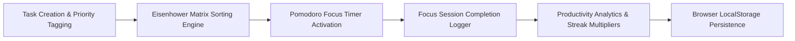

<div align="center">

  <!-- NATIVE ANIMATED CYBER BANNER -->
  

  <br/>

  <!-- ANIMATED TYPING SVG -->
  

  <br/>

  <!-- TECH BADGES -->
  <p align="center">
    
    
    
    
    
  </p>

</div>

---

### 🌟 System Overview

**ToDo+ Smart Study Assistant** is a modern, cognitive task management and productivity suite tailored for students and knowledge workers. It combines Eisenhower priority matrix categorization, integrated Pomodoro focus intervals, and persistent habit tracking into a responsive cyber-inspired interface.

---

### 🔬 Operational Architecture & Data Pipeline Flow



---

### 🚀 Key Capabilities & Features

- **⏱️ Integrated Pomodoro Focus Clock:** Alternates between 25-minute deep focus sprints and 5-minute restorative breaks.
- **🎯 Priority Matrix Classification:** Sorts tasks dynamically by urgency and impact (Eisenhower framework).
- **💾 Zero-Lag Local Persistence:** Saves all tasks, states, and completed metrics instantly to browser local storage.
- **📊 Daily Productivity Score:** Visual completion rings tracking percentage of planned tasks fulfilled.

---

### ⚡ Quickstart & Execution

```bash
# 1. Clone & open
git clone https://github.com/Akshay-Notfound/To-Do-App-.git
cd To-Do-App-

# 2. Open index.html in any modern browser!
```

---

### 👤 Author & Architecture

**Akshay Shivaji Rathod**  
*Data & AI Engineer*  
* 🌐 **Portfolio:** [akshay-notfound.vercel.app](https://akshay-notfound.vercel.app)  
* 💼 **LinkedIn:** [linkedin.com/in/akshay-rathod-aaab52206](https://www.linkedin.com/in/akshay-rathod-aaab52206/)  
* 🐙 **GitHub:** [@Akshay-Notfound](https://github.com/Akshay-Notfound)  

---

<div align="center">
  <sub>Licensed under the MIT License. Designed for scalability, intelligence, and performance.</sub>
</div>
